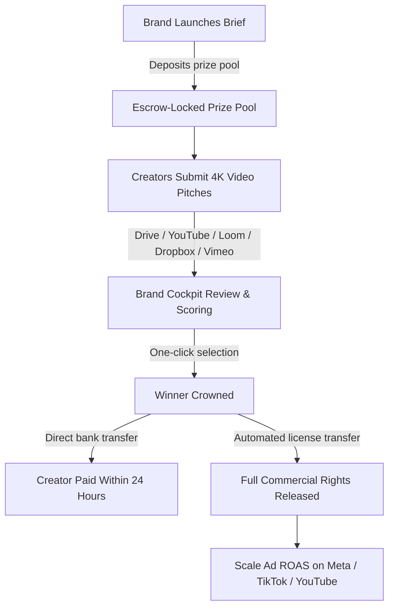

<div align="center">

# BrandForge

**The Escrow-Backed UGC Video Pitching & Creator Marketplace**

*Where high-growth D2C brands and India's top video creators forge high-converting ad content*

[](https://react.dev/)
[](https://vitejs.dev/)
[](https://tailwindcss.com/)
[](https://www.framer.com/motion/)
[](https://brand-forge-frontend.vercel.app)


---

</div>

---

## Overview

**BrandForge** is the marketing frontend for an end-to-end UGC (User-Generated Content) pitching platform that connects high-growth D2C brands with skilled video creators and UGC artists.

Traditional influencer marketing suffers from endless back-and-forth emails, rigid contracts, unverified creators, and zero content guarantees before payment. BrandForge replaces that friction with an **escrow-backed contest & pitch model**:

1. **Brands** launch hyper-targeted video briefs backed by guaranteed, escrow-locked prize pools (₹5,000 – ₹1,00,000+).
2. **Creators** stream raw uncompressed video pitches directly via Google Drive, YouTube, Loom, Dropbox, or Vimeo links — no file-size limits, no compression.
3. **Brands crown winning concepts in one click**, triggering direct bank payouts to creators within 24 hours and releasing full commercial usage rights for Meta, TikTok, and YouTube ads.

This repository contains the single-page React landing experience: an interactive product demo, live campaign explorer, ROI estimator, and the full platform narrative.

---

## Features

### iPhone Dynamic Island Navigation

A floating glassmorphic pill capsule fixed to the top of the viewport ([Navbar.jsx](src/components/Navbar.jsx)):

- Spring-physics drop-in entrance and a gliding `layoutId` indicator pill that animates between active links.
- Scroll-position section tracking with a programmatic-scroll lock (850 ms debounce) that eliminates the scroll-listener race condition and indicator jitter.
- Morphs into an expanded dropdown panel on mobile with animated height transitions.
- Sign In / Get Started actions wired to centralized auth URLs.

### Dual-Role Interactive Simulator

A working product preview toggled between two roles ([LandingPage.jsx](src/components/LandingPage.jsx)):

| Brand Cockpit | Creator Studio |
| :--- | :--- |
| Filter campaigns across `Approved` / `Pending Review` states | Paste-ready pitch submission supporting Drive, YouTube Unlisted, Loom, and Dropbox |
| Search campaigns by title and category | Live upload simulation with URL validation |
| Review creator submissions with metadata, platform source, and star ratings | Instant submission status feedback |
| One-click winner selection with canvas-confetti celebration | — |

### Real-Time Campaign Explorer

A discovery directory of live brand campaigns filterable by category — Beauty & Wellness, D2C Lifestyle, Tech & SaaS, Tech & Fintech, Food & Beverage, and Fitness Tech — with visual urgency indicators, prize-pool chips, deadline timers, and instant pitch submission triggers.

### Infinite Workflow Carousel

A 4-stage pipeline presented as a seamlessly looping carousel ([ScrollStackWorkflow.jsx](src/components/ScrollStackWorkflow.jsx)) — not a static list:

- Card track duplicated 5× (20 cards) with index normalization for an infinite loop with no visible seam.
- Autoplay progression that pauses on hover and during pointer interaction.
- Pointer drag and touch swipe with velocity-based flick detection and per-card snap.
- Arrow navigation controls and per-step animated UI mockups (brief composer, pitch review, payout release, ad-scale growth).

**The four stages:** Brief Launch & Prize Escrow → 4K Raw Video Pitching → Winner Crowning & 24h Payout → Ad ROAS Scale (3.4x average return).

### Interactive ROI & Value Estimator

A dual-mode calculator with live-computed metrics ([formulas](src/components/LandingPage.jsx#L398)):

- **Brand mode** — estimated videos produced (`budget / ₹10,000`), equivalent agency cost (`3.2× budget`), and total savings.
- **Creator mode** — projected monthly earnings (`pitches × ₹12,500`) based on submission volume.

### FAQ Accordion

Five expandable answers covering escrow mechanics, accepted pitch formats, commercial rights transfer, the no-follower-minimum policy, and 2-hour campaign moderation turnaround.

---

## Platform Workflow



---

## Architecture

Single-page application — every section lives on one route, composed of four components:

```
src/
├── App.jsx                        # Application shell, mounts LandingPage
├── main.jsx                       # React 19 entrypoint (StrictMode)
├── index.css                      # Tailwind v4 import, design tokens, keyframes, glass utilities
├── config/
│   └── appUrls.js                 # Centralized REGISTER_URL / LOGIN_URL auth endpoints
└── components/
    ├── Navbar.jsx                 # Dynamic Island pill nav with gliding indicator + mobile drawer
    ├── LandingPage.jsx            # Hero, simulator, value pillars, explorer, calculator, FAQ
    ├── ScrollStackWorkflow.jsx    # Infinite workflow carousel with drag/swipe + autoplay
    └── SectionDivider.jsx         # Gradient glow-line section transitions
```

**Landing page section map:**

| Section | Anchor | Contents |
| :--- | :--- | :--- |
| Hero | `#hero` | Headline, dual CTAs (Launch a Campaign / Join as Creator), ambient glow orbs |
| Live Simulator | `#live-demo` | Brand cockpit and creator studio role toggle |
| Value Pillars | `#for-brands` | Side-by-side brand and creator benefit breakdowns |
| Campaign Explorer | `#campaigns-explorer` | Category-filtered live campaign directory |
| Workflow Carousel | `#how-it-works` | Looping 4-stage pipeline with mockups |
| ROI Calculator | `#roi-calculator` | Brand / creator mode estimator |
| FAQ | `#faq` | Escrow, formats, rights, payouts |

---

## Design System

Brand tokens are defined as CSS custom properties in [`src/index.css`](src/index.css) and mirrored throughout components:

- **Palette** — deep indigo base (`#1e1b4b`), brand purple (`#8b5cf6` / `#7c3aed`), indigo accent (`#4f46e5`), amber and emerald for payout/growth states.
- **Typography** — Plus Jakarta Sans (primary) and Inter (fallback), loaded via Google Fonts with weights 300–900.
- **Surfaces** — glassmorphism utilities (`glass-panel`, `glass-card-dark`) using layered `backdrop-blur`, translucent purple borders, and multi-layer shadows.
- **Ambience** — radial dot-mesh patterns, blurred glow orbs, and `floatSlow` / `pulseGlow` / `shimmerEffect` keyframe animations.
- **Detailing** — scrollbars hidden globally, smooth scrolling, `overflow-x` guarded.

---

## Tech Stack

| Category | Technology | Purpose |
| :--- | :--- | :--- |
| Framework | [React 19](https://react.dev/) | UI library (hooks, StrictMode, concurrent rendering) |
| Build tool | [Vite 7](https://vitejs.dev/) | Dev server with HMR and production bundling |
| Styling | [Tailwind CSS v4](https://tailwindcss.com/) | Utility-first styling via `@tailwindcss/vite` plugin |
| Animation | [Framer Motion 12](https://www.framer.com/motion/) | Springs, layout animations, gestures, scroll reveals |
| Icons | [Lucide React](https://lucide.dev/) | Icon suite |
| Interactivity | [canvas-confetti](https://www.npmjs.com/package/canvas-confetti) | Winner-selection celebrations |
| Smooth scroll | [Lenis](https://lenis.darkroom.engineering/) | Kinetic scroll engine |
| Code quality | [ESLint 9](https://eslint.org/) | Flat config with React Hooks and Refresh plugins |

---

## Getting Started

**Prerequisites:** Node.js `v18+` and npm (or pnpm / yarn).

```bash
# 1. Clone
git clone https://github.com/RohitChintalapudi/BrandForge_landingpage.git
cd BrandForge_landingpage

# 2. Install dependencies
npm install

# 3. Start the dev server (http://localhost:5173)
npm run dev
```

## Configuration

Auth and platform redirection endpoints are centralized in [`src/config/appUrls.js`](src/config/appUrls.js):

```javascript
export const REGISTER_URL = "https://brand-forge-frontend.vercel.app";
export const LOGIN_URL = "https://brand-forge-frontend.vercel.app";
```

Point these at a custom backend or staging environment directly, or migrate them to Vite environment variables (`import.meta.env.VITE_*`) for per-deploy overrides.

## Scripts

| Command | Description |
| :--- | :--- |
| `npm run dev` | Vite dev server with hot module replacement |
| `npm run build` | Production build into `dist/` |
| `npm run preview` | Preview the production build locally |
| `npm run lint` | ESLint check across the project |

## Deployment

Optimized for [Vercel](https://vercel.com/) or [Netlify](https://www.netlify.com/):

1. Link the GitHub repository.
2. Select the **Vite** preset (build command `npm run build`, output directory `dist`).
3. Deploy.

Production URL: **[brand-forge-frontend.vercel.app](https://brand-forge-frontend.vercel.app)**
